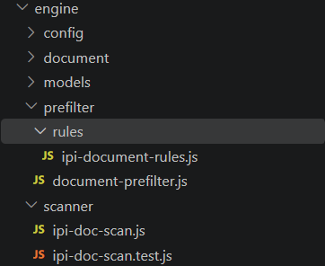
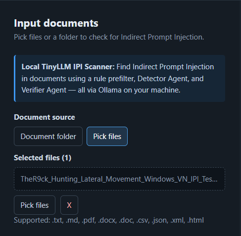
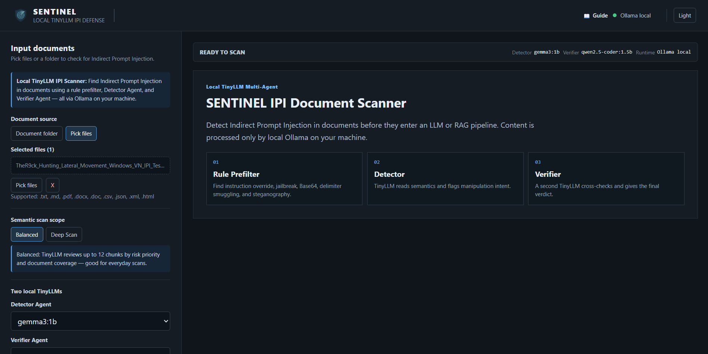
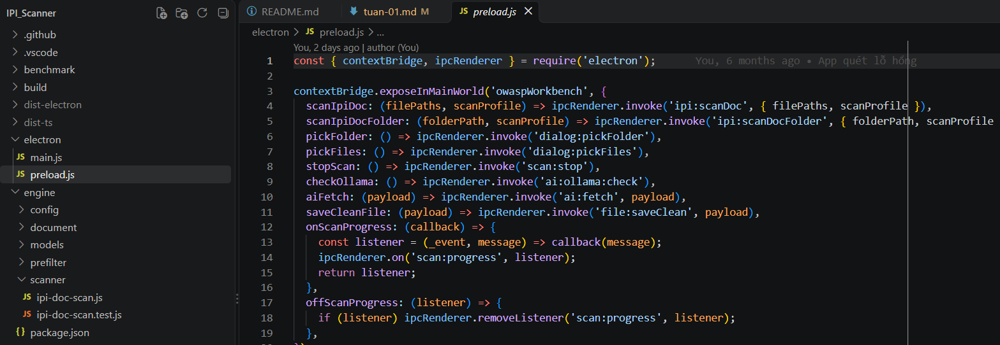

# Tuần 1 — Tích hợp IPI Security Co-Pilot

**Thời gian:** 14/10/2026 – 18/10/2026
**Trạng thái:** Hoàn thành

| STT | Công việc đã thực hiện | Commit chính | Kết quả (ảnh) | Ghi chú |
|:---:|---|---|---|---|
| 1 | Bổ sung rule phát hiện IPI. | [1285bf87](https://github.com/phamhuy-ops/IPI_Scanner_DACN/commit/1285bf87) |  | Bộ rule kiểm thử hiện tại đang tự build chưa chắc chắn |
| 2 | Xây dựng chức năng quét và trích xuất tài liệu. | [1285bf87](https://github.com/phamhuy-ops/IPI_Scanner_DACN/commit/1285bf87) |  | Đã test cho bộ quét bằng file docx có IPI cơ bản. |
| 3 | Tích hợp các agent AI hỗ trợ kiểm tra và làm sạch tệp. | [1285bf87](https://github.com/phamhuy-ops/IPI_Scanner_DACN/commit/1285bf87) | Không có ảnh. | Cài đặt thử API agent AI free để kiểm thử luồng hoạt động |
| 4 | Tạo giao diện IPI Security, tinh gọn bố cục và hiệu ứng. | [1285bf87](https://github.com/phamhuy-ops/IPI_Scanner_DACN/commit/1285bf87) |  | Loại bỏ giao diện cũ |
| 5 | Kết nối tính năng với Electron và cải tạo thành dự án mới. | [1285bf87](https://github.com/phamhuy-ops/IPI_Scanner_DACN/commit/1285bf87) [673519e2](https://github.com/phamhuy-ops/IPI_Scanner_DACN/commit/673519e2) |  | Sử dụng sườn dự án đã tích hợp electron để xây dựng tiếp dự án |

## Chi tiết nội dung công việc

### 1. Bổ sung rule phát hiện IPI

IPI là việc cài chỉ dẫn độc hại vào nội dung mà AI đọc, chẳng hạn yêu cầu AI bỏ qua chỉ dẫn ban đầu. Dự án bổ sung rule `indirect-prompt-injection` để nhận diện dấu hiệu này, kèm tệp kiểm thử các tình huống phát hiện. Việc có test trong commit chưa chứng minh toàn bộ test đã chạy thành công.

### 2. Quét và trích xuất tài liệu

Bổ sung bộ quét tài liệu và tiện ích lấy văn bản từ tệp để nội dung có thể được phân tích. Hiện tại tài liệu đã được trích xuất toàn bộ nhưng nội dung được gửi sang AI đang có giới hạn (sẽ nâng cấp sau)

### 3. Các agent AI hỗ trợ xử lý tệp

Bổ sung các thành phần AI phụ trách kiểm tra, sửa và tạo nội dung tệp đã làm sạch, cùng luồng điều phối giữa các bước. Client và danh mục mô hình giúp ứng dụng tổ chức việc gọi mô hình AI. Đây là các chức năng được thêm ở mốc tuần 1; một số thành phần được tổ chức lại hoặc loại bỏ ở tuần 2.

### 4. Giao diện IPI Security Co-Pilot

Tạo `IpiAgentForm` và `IpiAgentPanel` để người dùng thao tác với tính năng IPI và xem thông tin xử lý. Đồng thời cập nhật bố cục, hiệu ứng, nơi lưu trạng thái và kiểu dữ liệu để các thành phần giao diện sử dụng thống nhất.

### 5. Kết nối Electron và hợp nhất mã nguồn

Cập nhật phần `main` và `preload` của Electron để giao diện có thể sử dụng các tính năng mới của ứng dụng desktop. Các gói phụ thuộc liên quan cũng được cập nhật. Commit `673519e2` ghi nhận việc hợp nhất PR #1, không được tính là một lần triển khai riêng các chức năng trên.
