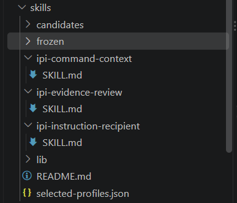
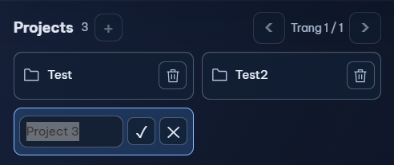
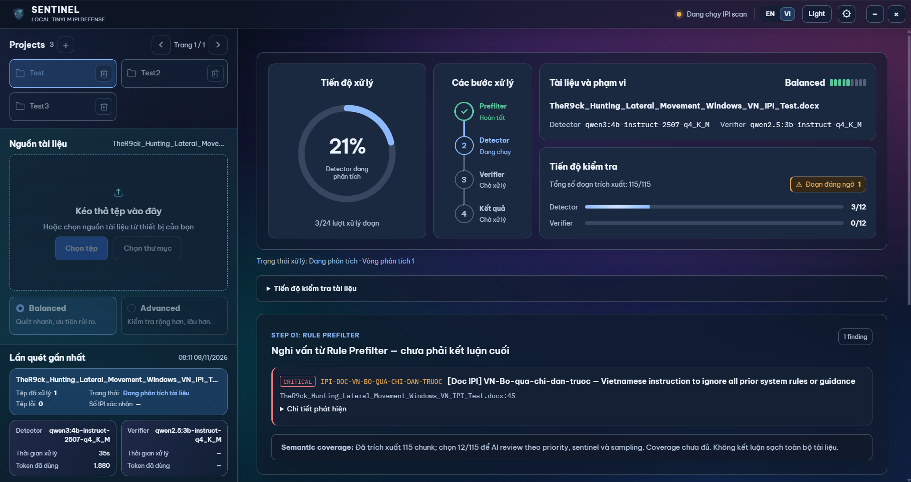
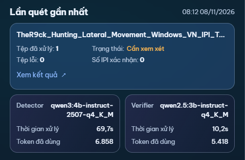

# Tuần 04 — Nâng cấp giao diện SENTINEL và kiểm chứng luồng quét IPI

**Thời gian** 02/11/2026 – 08/11/2026
**Trạng thái** Đã cập nhật giao diện và quản lý dự án. Việc kiểm chứng chất lượng nhận diện vẫn đang thực hiện.

| STT | Công việc đã thực hiện | Commit chính | Kết quả (ảnh) | Ghi chú |
|:---:|---|---|---|---|
| 1 | Xây dựng và thử ba bộ skill cho Agent. | [36e662d0](https://github.com/phamhuy-ops/IPI_Scanner_DACN/commit/36e662d0) |  [Kết quả thử tích hợp](../skills/frozen/integration-status.json) | Đã thử trong luồng quét. Chưa bật mặc định. |
| 2 | Thêm quản lý dự án quét. | [58c7cdcd](https://github.com/phamhuy-ops/IPI_Scanner_DACN/commit/58c7cdcd), [658615e2](https://github.com/phamhuy-ops/IPI_Scanner_DACN/commit/658615e2) |  [Kiểm thử lưu và chuyển dự án](../src/store/useProjects.test.ts) | Có thể tách dữ liệu làm việc theo từng dự án. |
| 3 | Cập nhật giao diện chọn tài liệu, cấu hình mô hình và xem kết quả. | [58c7cdcd](https://github.com/phamhuy-ops/IPI_Scanner_DACN/commit/58c7cdcd), [658615e2](https://github.com/phamhuy-ops/IPI_Scanner_DACN/commit/658615e2), [03a8acf0](https://github.com/phamhuy-ops/IPI_Scanner_DACN/commit/03a8acf0) |  [Thành phần kết quả quét](../src/components/LatestScan.tsx) | Bố cục và cách trình bày kết quả đã được cập nhật. |
| 4 | Hiển thị tiến độ và số liệu xử lý theo từng Agent. | Chưa commit |  [Kiểm thử tiến độ](../src/components/ScanActivity.test.tsx) | Có tên mô hình, thời gian, số lượt gọi và số token khi mô hình trả về số liệu. |
| 5 | Điều chỉnh cách chạy hai mô hình local và xử lý lỗi đầu ra. | Chưa commit | Không có ảnh. [Kiểm thử phục hồi](../src/ai/agents/document/runtimeRecovery.integration.test.ts), [kiểm thử đầu ra bị cắt](../src/ai/agents/slmTruncation.integration.test.ts) | Đã kiểm tra bằng phản hồi mô phỏng. Cần chạy lại với Ollama thật. |

## Chi tiết nội dung công việc

### 1. Thử ba bộ hướng dẫn cho Agent

Ba skill tập trung vào ba câu hỏi. Chỉ dẫn này gửi cho ai? Đây là lệnh thật hay câu được đưa vào làm ví dụ? Đoạn tài liệu nào chứng minh nhận định đó? Ví dụ, khi tài liệu giải thích cụm “bỏ qua hướng dẫn trước đó” như một mẫu tấn công, Agent cần đọc phần giải thích xung quanh trước khi kết luận.

Trên bộ mẫu dùng để phát triển, hai skill về người nhận và ngữ cảnh đạt 13/18 mỗi skill. Bản kiểm tra bằng chứng với lời giải thích ngắn đạt 15/18. Khi thử cả luồng trên 12 mẫu tách nhóm, luồng gốc trả lời đúng 7/12, còn bản tích hợp đúng 5/12. Bộ 12 mẫu đã được xem kết quả và chưa độc lập về nguồn. Vì bản tích hợp cho kết quả thấp hơn, ba skill vẫn chỉ dùng trong chế độ thử nghiệm. [Tiến độ Ưu tiên 1](../docs/planning/tien-do-uu-tien-1.md), [quyết định tích hợp](../skills/frozen/integration-status.json).

### 2. Quản lý công việc theo dự án

Thêm bộ chọn dự án để người dùng có thể tạo và chuyển giữa các nhóm công việc. Chẳng hạn, có thể mở một dự án dành cho tài liệu demo và một dự án riêng cho tài liệu kiểm thử. Khi đổi dự án, ứng dụng khôi phục dữ liệu làm việc đã lưu của dự án được chọn. [Kiểm thử quản lý dự án](../src/store/useProjects.test.ts).

### 3. Sắp xếp lại giao diện quét

Cập nhật khu vực chọn tệp hoặc thư mục, khu vực thiết lập mô hình và phần xem kết luận. Màn hình chính có ô kết quả lần quét gần nhất để người dùng xem nhanh và mở phần kết luận chi tiết. Bố cục và kiểu hiển thị cũng được điều chỉnh cho các kích thước cửa sổ khác nhau. [Màn hình chính](../src/App.tsx), [kết quả lần quét gần nhất](../src/components/LatestScan.tsx).

### 4. Làm rõ tiến độ và lỗi trong lúc quét

Bản thay đổi cục bộ hiển thị các mốc xử lý từ bước lọc sơ bộ đến Detector và Verifier. Detector tìm đoạn đáng ngờ, còn Verifier kiểm tra lại bằng chứng. Mỗi Agent có thông tin về mô hình đang dùng và số liệu xử lý khi có dữ liệu. Ô kết luận cũng hiển thị tên nguồn và lý do ngắn khi lần quét gặp lỗi, chẳng hạn quá thời gian hoặc thiếu mô hình. [Tiến độ quét](../src/components/ScanActivity.tsx), [ô kết quả](../src/components/LatestScan.tsx).

### 5. Điều chỉnh vận hành mô hình local

Bản cục bộ cập nhật cấu hình desktop cho Detector và Verifier, đồng thời kiểm tra Ollama đã giải phóng Detector trước khi nạp Verifier. Mục đích là hạn chế việc hai mô hình cùng chiếm bộ nhớ. Luồng Detector cũng có thêm cách thử lại khi phản hồi bị cắt hoặc lặp. Các điều chỉnh này cần đo bằng mô hình thật để biết ảnh hưởng đến tỷ lệ lỗi, thời gian quét và tài nguyên. [Luồng quét](../src/ai/agents/document/ipiPipeline.ts), [xử lý phản hồi Detector](../src/ai/agents/document/detectorAgent.ts).

Khi lập báo cáo, đã chạy **56 kiểm thử tự động và cả 56 đều đạt**. Phạm vi gồm quản lý dự án, hiển thị tiến độ và kết quả, phục hồi lỗi và phản hồi bị cắt. Phép kiểm tra này xác nhận hành vi của mã trong các tình huống kiểm thử. Chưa có kết quả thao tác qua Electron, phép đo mô hình thật hoặc ảnh chụp giao diện cho bản cục bộ. Lệnh kiểm tra:

```powershell
npm test -- --run src/components/LatestScan.test.tsx src/components/ScanActivity.test.tsx src/store/useProjects.test.ts src/ai/agents/document/runtimeRecovery.integration.test.ts src/ai/agents/slmTruncation.integration.test.ts
```

## Khó khăn chưa giải quyết được

1. **Ba skill chưa giúp cả luồng quét nhận diện tốt hơn trong đợt thử tích hợp.** Khi Detector bỏ sót một đoạn, các skill ở bước sau có thể thiếu nội dung để xem xét. Một số ca còn lỗi định dạng phản hồi, trích dẫn hoặc hết thời gian. Mục tiêu nhận diện đúng 90% vẫn chưa được xác nhận.
2. **Tài liệu dài và chi phí chạy mô hình còn cần đo.** Cần xác định bao nhiêu đoạn được xem, bao nhiêu yêu cầu phải thử lại và việc lần lượt nạp hai mô hình ảnh hưởng thế nào đến thời gian, RAM và VRAM.
3. **Chưa kiểm tra đầy đủ thao tác desktop.** Kiểm thử tự động đã qua ở các phần chọn lọc. Còn cần mở ứng dụng thật để kiểm tra chuyển dự án, quét, xem bằng chứng và xuất báo cáo, đồng thời bổ sung ảnh minh chứng.

## Công việc tiếp theo

- Kiểm tra luồng desktop với Ollama thật từ tạo hoặc chuyển dự án, chọn tệp, theo dõi tiến độ đến xem bằng chứng và xuất báo cáo. Bổ sung ảnh cho các bước chính.

- Tái hiện các ca Detector bỏ sót, phản hồi sai định dạng hoặc sai trích dẫn trên bộ dev. Sửa từng lỗi, kèm mẫu tấn công, mẫu sạch gần giống và biến thể chưa dùng trước đó.

- Khóa cấu hình trước khi thử trên nguồn độc lập mới. So sánh luồng có và không có skill trên cùng đầu vào, ghi số ca đúng và sai, precision, recall, F1 và tỷ lệ báo nhầm theo nguồn.

- Quét tài liệu PDF và Word tiếng Việt nhiều trang. Ghi độ bao phủ khi trích xuất và chọn
đoạn, thời gian, RAM/VRAM và lỗi ở từng bước. Dùng kết quả để đánh giá cấu hình mô hình và quyết định có đưa các skill vào mặc định hay không.
